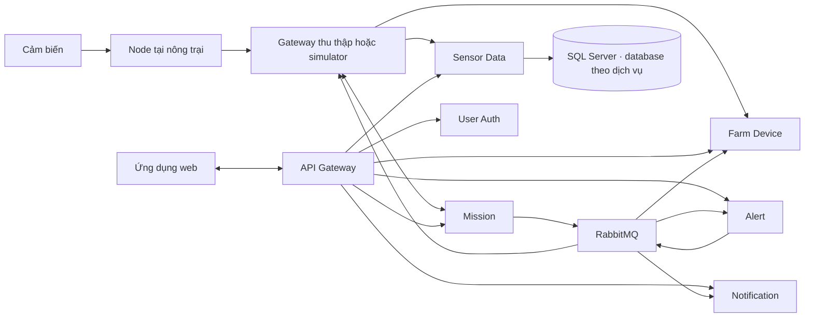
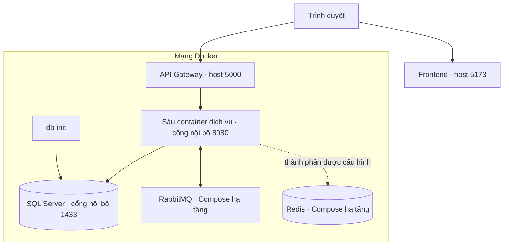

# 04 System Architecture — Kiến trúc hệ thống

**Trạng thái:** Bản thảo đối chiếu mã nguồn · **Cập nhật:** 27/11/2026 · **Phụ trách:** Nhóm kiến trúc, cá nhân chưa xác minh.

Nền tảng thu nhận dữ liệu cảm biến ở nông trại, gắn dữ liệu với thiết bị và nhiệm vụ, rồi cung cấp dữ liệu lịch sử và cảnh báo cho ứng dụng web. Kiến trúc bốn lớp mô tả đường đi của dữ liệu và ranh giới trách nhiệm. Quyết định công nghệ căn cứ theo checkout `dev_chien` tại `612e00b`, xem [mốc mã nguồn](https://github.com/huylam0703/version7/tree/612e00b).

## 4.1 Kiến trúc tổng thể bốn lớp

| Lớp | Đầu vào chính | Đầu ra và trách nhiệm |
| --- | --- | --- |
| Cảm biến và node | Giá trị vật lý tại điểm đo | Chuyển phép đo thành bản ghi có thể gắn với một node và kênh đo |
| Gateway di động trên UAV | Kế hoạch thu thập và dữ liệu từ node | Thu nhận, chuẩn hóa, gửi bản ghi và tiến độ về máy chủ |
| Máy chủ | Request từ web, request đồng bộ, sự kiện nghiệp vụ | Xác thực, kiểm tra tham chiếu, lưu dữ liệu, tính toán cảnh báo và tạo thông báo |
| Ứng dụng web | Dữ liệu và quyền truy cập từ máy chủ | Hiển thị hiện trạng, lịch sử và tiến độ, hỗ trợ thao tác quản trị và vận hành |

Dữ liệu đo đi từ node về máy chủ qua thành phần thu thập. Kế hoạch và trạng thái nhiệm vụ đi theo chiều ngược lại giữa backend và thành phần thu thập. Web đọc và cập nhật dữ liệu qua hợp đồng HTTP. Với xử lý nền, dịch vụ tiếp nhận và dịch vụ phản ứng có thể chạy ở các thời điểm khác nhau, vì vậy số liệu và thông báo có thể xuất hiện lệch nhau trong một khoảng ngắn.

## 4.2 Lớp cảm biến

Node là điểm thu thập tại hiện trường. Một node có thể có nhiều kênh, mỗi kênh mang một loại phép đo. Nhiệt độ, độ ẩm không khí và độ ẩm đất là ví dụ về dữ liệu nông nghiệp. Danh mục mã và đơn vị thực tế cần đối chiếu `SensorTypeSeeder` cùng cấu hình node đang dùng. Việc tách node khỏi kênh giúp hệ thống giữ danh tính thiết bị khi thay đổi loại phép đo.

Thiết kế dự kiến node giữ tạm mẫu khi gateway chưa tiếp cận. **CHƯA XÁC MINH** cơ chế lưu trên node, dung lượng bộ đệm và quy trình xác nhận đã nhận mẫu sau khi mất nguồn. Hồ sơ phần cứng, firmware và BOM thuộc mục 3.10 và 10.8. Phần mềm máy chủ sử dụng định danh đã đăng ký để gắn phép đo vào đối tượng nghiệp vụ tương ứng.

## 4.3 Lớp gateway di động trên UAV

UAV là phương tiện mang thiết bị thu thập trong mô hình hiện trường. Gateway chịu trách nhiệm tích hợp với node và hệ thống máy chủ. Trong mã nguồn, `uav-gateway-simulator` đảm nhiệm vai trò mô phỏng thực thi nhiệm vụ và có client đọc ESP32. Phần kế hoạch, waypoint và tiến độ trên nền tảng phục vụ điều phối thu thập dữ liệu.

Gateway cần tra cứu node được giao, dùng cấu hình kết nối phù hợp, chuẩn hóa dữ liệu và trả kết quả tương ứng với từng lần thực thi. Khi mô tả vị trí, cần xác định đó là tọa độ cấu hình của node, waypoint hay tọa độ đo thực tế. Khi mô tả thời gian, cần phân biệt lúc đo với lúc máy chủ nhận. Bằng chứng về thiết bị bay và lưu trữ offline bền vững được theo dõi ở mục 5.12.

## 4.4 Lớp máy chủ

Máy chủ kiểm tra danh tính, quyền và định dạng dữ liệu trước khi ghi. Lớp này nối dữ liệu đo với thiết bị và nhiệm vụ, phục vụ truy vấn và phát sinh cảnh báo theo quy tắc được triển khai. Quá trình ghi dữ liệu, đánh giá ngưỡng và chuyển thành thông báo là các bước có thể kiểm tra độc lập. Vì vậy, khi phép đo đã xuất hiện nhưng hộp thư vẫn trống, cần truy vết tiếp xử lý sự kiện và người nhận.

## 4.5 Lớp ứng dụng web

Nhóm màn hình quản trị hỗ trợ xem dashboard, nông trại, vùng, người dùng, lịch sử, cảnh báo và báo cáo. Nhóm vận hành tập trung vào UAV, gateway, node, kế hoạch và tiến độ nhiệm vụ. Hộp thư cá nhân là điểm truy cập dùng chung theo quyền. UI thể hiện trạng thái tải, rỗng hoặc lỗi dựa vào kết quả API, còn quyết định cho phép truy cập tài nguyên được thực thi ở backend. Wireframe và luồng màn hình thuộc mục 3.8.

## 4.6 Sơ đồ kiến trúc tổng thể

Sơ đồ thể hiện các hướng tích hợp chính. Khối SQL Server minh họa nơi lưu dữ liệu trung tâm, còn quan hệ sở hữu từng database nằm trong bảng 4.8. Khối Mermaid là nguồn chỉnh sửa của sơ đồ. Khi đưa lên Confluence, có thể dùng macro Mermaid của workspace hoặc xuất ảnh từ cùng khối nguồn.

## 4.7 Luồng dữ liệu

1. Node tạo mẫu và gắn định danh, thời điểm đo, mã loại cảm biến và giá trị theo hợp đồng. Nếu nhận nhiều phép đo từ một node, giữ liên hệ từng mẫu với kênh tương ứng.
2. Gateway lấy dữ liệu theo nhiệm vụ, ánh xạ sang DTO của Sensor Data và gửi kết quả thu nhận. Dữ liệu đọc và kết quả tổng hợp của Mission có vòng đời riêng.
3. Thiết kế offline đặt một hàng đợi bền vững như SQLite giữa thu nhận và gửi. Hàng đợi dự kiến giữ dữ liệu chờ, trạng thái gửi và khóa chống trùng. Mốc Git có vùng chờ retry kết quả nhiệm vụ trong RAM. Bản cập nhật workspace đã bổ sung lưu payload kết quả xuống đĩa. Phạm vi và kiểm thử tại 5.12.
4. Sensor Data xác thực, kiểm tra nội dung, tiếp nhận dữ liệu đơn hoặc batch và lưu vào database của mình. Khi retry, client cần giữ định danh lần gửi phù hợp với hợp đồng và đọc phản hồi cấp batch lẫn cấp bản ghi.
5. Dashboard truy vấn dữ liệu gần nhất hoặc chuỗi lịch sử theo bộ lọc. Khi xử lý cảnh báo, đọc log của từng chặng từ consumer đọc dữ liệu đến bước tạo thông báo để xác định điểm dừng.

## 4.8 Thiết kế backend service

| Thành phần | Database | Phạm vi và mã F theo đề cương |
| --- | --- | --- |
| User Auth | `user_auth_db` | Đăng nhập, quản lý người dùng và định danh dịch vụ. F01, F02 |
| Farm Device | `farm_device_db` | Nông trại, vùng, node, UAV, gateway và tham chiếu thiết bị. F03, F05, F12, F13, F18 |
| Mission | `mission_db` | Kế hoạch, vòng đời, tiến độ và kết quả nhiệm vụ. F14–F17 |
| Sensor Data | `sensor_data_db` | Dữ liệu đo, truy vấn lịch sử, chất lượng dữ liệu và đồng bộ. F06, F07, F19, F20 |
| Alert | `alert_db` | Phát hiện và xử lý cảnh báo. F08, F09 |
| Notification | `notification_db` | Hộp thư cá nhân và xử lý gửi thông báo. F10 |
| API Gateway | — | Cửa vào web và proxy định tuyến. Dashboard và báo cáo dùng API qua Gateway. BFF tổng hợp chuyên biệt cần đối chiếu theo từng tuyến. |

| Event | Vai trò và bằng chứng |
| --- | --- |
| `readings.synced` | Hợp đồng thông báo phép đo đã đồng bộ. Alert có listener và binding. Cần kiểm chứng luồng phát → nhận trên môi trường chạy. |
| `node.state_updated` | Có schema trong contracts. Tích hợp producer và consumer cần xác minh. |
| `batch.synced` | Có schema cho kết quả đồng bộ theo đợt. Tình trạng phát và nhận cần xác minh. |
| `mission.status_changed` | Farm Device xử lý thay đổi trạng thái UAV/gateway. Notification có binding xử lý thông báo theo trạng thái. |
| `alert.created` | Alert có publisher sau commit. Notification có binding tiếp nhận. |
| `mission.ready` | Event bổ sung của luồng thực thi, Mission có outbox và simulator có consumer. |

## 4.9 Giao tiếp giữa các thành phần

Web gửi HTTP JSON qua API Gateway. Để xác minh một tuyến, lần theo URL gọi ở frontend, route và transform tại Gateway, sau đó tìm annotation ở controller đích. Mission gọi Farm Device để kiểm tra các tham chiếu nghiệp vụ. Simulator có client riêng tới Sensor Data, Mission và Farm Device. Các đường nội bộ cần kiểm tra quyền dịch vụ tương ứng.

RabbitMQ tách bước phát sự kiện khỏi bước xử lý. Hợp đồng nền tảng quy định exchange topic `farm.events` cùng envelope có `eventId`, `eventType`, `version`, `occurredAt`, `producer`, `traceId` và `payload`. Đọc cấu hình binding của từng ứng dụng trước khi kết luận một schema đang phục vụ luồng runtime. Tra cứu theo `DeviceUid` có route nội bộ trong Farm Device. Phạm vi, TTL và quy tắc làm mới cache theo `DeviceUid` cần xác minh riêng.

## 4.10 Công nghệ và môi trường triển khai

| Thành phần | Công nghệ tại mốc đối chiếu | Cổng host theo Compose |
| --- | --- | --- |
| Frontend | React, TypeScript, Vite, container phục vụ web | 5173 → 80 |
| API Gateway | ASP.NET Core, YARP | 5000 → 8080 |
| Sáu dịch vụ nghiệp vụ | .NET 10 và Java 21/Spring Boot | 8081–8086 → 8080 theo thứ tự bảng 4.8 |
| Database | SQL Server 2022, job `db-init` | 14330 → 1433 |
| Hạ tầng phụ trợ | RabbitMQ 3.13 Management, Redis 7 Alpine trong Compose hạ tầng | Tra `docker-compose.infra.yml` |
| Simulator | Java 21/Spring Boot | Xác định theo profile thực chạy |

Địa chỉ phụ thuộc nơi tiến trình đang chạy. Ứng dụng trong mạng Docker dùng tên dịch vụ và cổng nội bộ. Công cụ host dùng cổng được publish. Khi ghép hai Compose, kiểm tra điều kiện dùng chung mạng Docker và biến môi trường. Phần simulator trong Compose chính tại mốc Git đang được chú thích. Xem [Compose ứng dụng](https://github.com/huylam0703/version7/blob/612e00b/farm-monitoring-platform/deploy/docker-compose.yml) và [Compose hạ tầng](https://github.com/huylam0703/version7/blob/612e00b/farm-monitoring-platform/deploy/docker-compose.infra.yml).

## 4.11 Nhật ký quyết định kiến trúc

| Bối cảnh | Lựa chọn thấy trong mã | Căn cứ và hệ quả |
| --- | --- | --- |
| Chốt SQL Server hay PostgreSQL | SQL Server 2022 | Compose, JDBC và script SQL cùng chỉ tới SQL Server. Việc sử dụng cú pháp T-SQL và ánh xạ kiểu dữ liệu yêu cầu rà migration và truy vấn nếu đổi hệ quản trị. |
| Một API hay sáu dịch vụ | Sáu dịch vụ nghiệp vụ qua một API Gateway | Mỗi miền sở hữu dữ liệu và có tiến trình riêng. Hệ quả là cần kiểm tra sự tương thích hợp đồng và theo dõi các phụ thuộc khi khởi động. |
| Chọn broker | RabbitMQ | Compose hạ tầng và binding trong các consumer xác nhận RabbitMQ. Retry và chống trùng phải được kiểm tra theo từng consumer. |
| Chọn ngôn ngữ backend | .NET 10 và Java 21 | Gateway, User Auth, Notification dùng .NET. Farm Device, Mission, Sensor Data, Alert và simulator dùng Java. Việc tích hợp dựa trên hợp đồng HTTP, JWT, JSON và event. |
| Lưu tạm offline | Bản workspace lưu payload kết quả nhiệm vụ bằng tệp JSON. Hàng đợi phép đo bằng SQLite thuộc thiết kế | Retry trong cùng tiến trình và khôi phục sau tái khởi động là hai tiêu chí nghiệm thu khác nhau. |

Ngày phê duyệt và người ra quyết định cần bổ sung từ biên bản của nhóm. Các mục 1.7, 5.3 và 9.8 có thể dẫn về bảng này.
